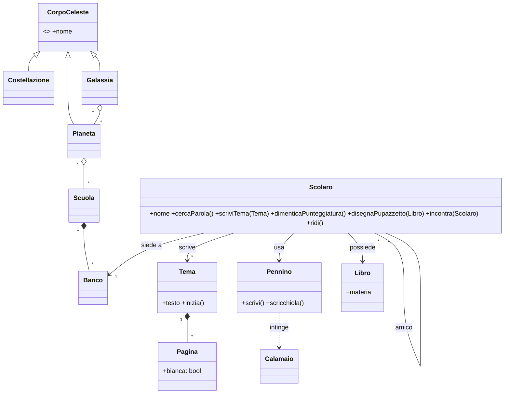
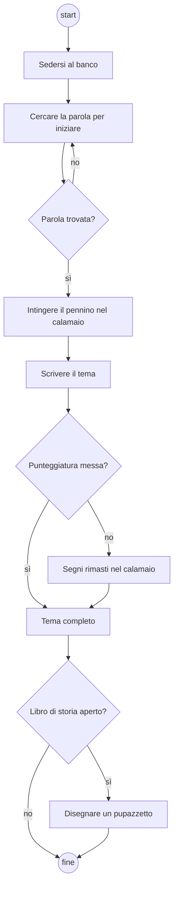
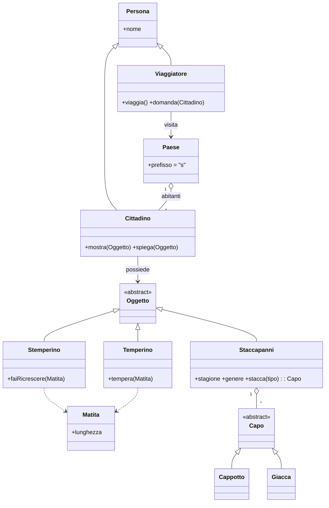
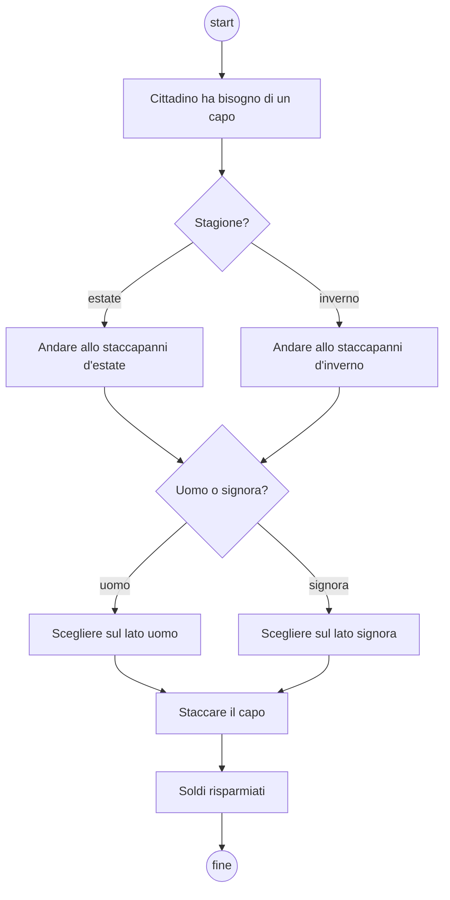
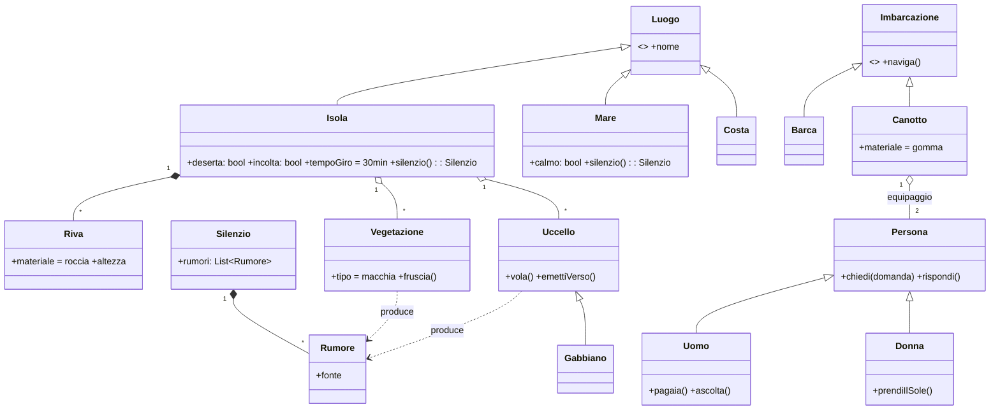
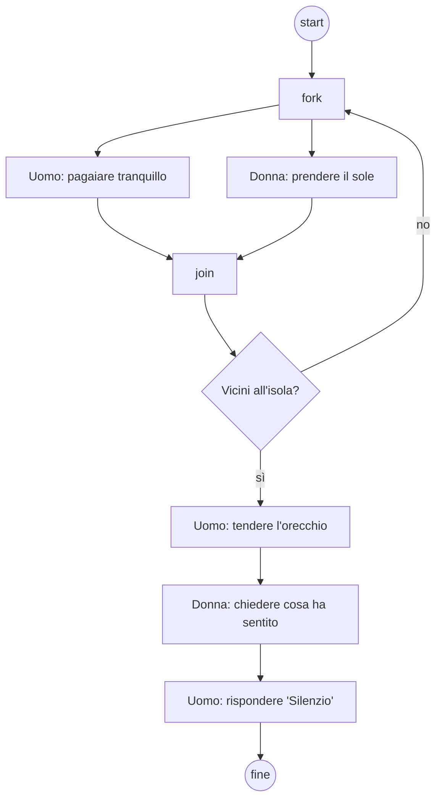

## [aperta 3] Si descriva il design pattern factory method e si evidenzi la sua struttura in un linguaggio di programmazione a scelta.

### Soluzione
**Factory Method** (GoF, creazionale): definisce un'interfaccia per creare un oggetto ma lascia alle **sottoclassi** decidere quale classe concreta istanziare. Il codice che usa il prodotto dipende solo dall'astrazione `Prodotto`, non dalle classi concrete.

Partecipanti: `Product` (interfaccia), `ConcreteProduct`, `Creator` (dichiara `factoryMethod()` e la usa nelle sue operazioni), `ConcreteCreator` (ridefinisce `factoryMethod()` restituendo il prodotto concreto).

```python
from abc import ABC, abstractmethod

class Documento(ABC):                 # Product
    @abstractmethod
    def apri(self): ...

class Pdf(Documento):                 # ConcreteProduct
    def apri(self): print("apro PDF")

class Editor(ABC):                    # Creator
    @abstractmethod
    def crea_documento(self) -> Documento: ...   # factory method
    def nuovo(self):
        d = self.crea_documento()     # non sa quale classe concreta
        d.apri()
        return d

class EditorPdf(Editor):              # ConcreteCreator
    def crea_documento(self): return Pdf()

EditorPdf().nuovo()
```
Vantaggi: rispetta open/closed (nuovo prodotto = nuova sottoclasse, senza toccare `Editor`), basso accoppiamento. Svantaggio: una gerarchia di creator parallela a quella dei prodotti.

### Griglia
- 1 | Intento: creazione delegata alle sottoclassi, il client dipende dall'astrazione
- 1 | Struttura: Product / ConcreteProduct / Creator / ConcreteCreator
- 1 | Codice corretto in un linguaggio a scelta

## [aperta 3] Si descriva il design pattern del prototype e si evidenzi la sua struttura specifica in Java.

### Soluzione
**Prototype** (GoF, creazionale): si creano nuovi oggetti **clonando un'istanza prototipo** invece di invocare un costruttore. Utile quando la creazione è costosa o la classe concreta è nota solo a runtime.

Partecipanti: `Prototype` (dichiara `clone()`), `ConcretePrototype` (implementa la copia), `Client` (chiede al prototipo di clonarsi).

In Java si implementa `Cloneable` e si ridefinisce `Object.clone()` (che fa una copia **superficiale**; i campi mutabili vanno copiati a mano per una copia profonda):

```java
public class Forma implements Cloneable {
    private String colore;
    private List<Punto> punti = new ArrayList<>();

    @Override
    public Forma clone() {
        try {
            Forma f = (Forma) super.clone();       // copia campo a campo
            f.punti = new ArrayList<>(this.punti); // deep copy della parte mutabile
            return f;
        } catch (CloneNotSupportedException e) {
            throw new AssertionError(e);
        }
    }
}

Forma prototipo = new Forma();
Forma copia = prototipo.clone();
```
Senza `implements Cloneable`, `super.clone()` lancia `CloneNotSupportedException`. Alternativa idiomatica: copy constructor `new Forma(altra)`. Spesso i prototipi stanno in un registro (mappa nome → prototipo).

### Griglia
- 1 | Intento: creazione per clonazione di un prototipo
- 1 | Struttura: Prototype / ConcretePrototype / Client (eventuale registro)
- 1 | Java: Cloneable + override di clone(), copia superficiale vs profonda

## Contesto
Si consideri la seguente poesia di Gianni Rodari, "Distrazione interplanetaria":

> Chissà se a quest'ora su Marte, / su Mercurio o Nettuno, / qualcuno / in un banco di scuola / sta cercando la parola / che gli manca / per cominciare il tema / sulla pagina bianca.
> E certo nel cielo di Orione, / dei Gemelli, del Leone, / un altro dimentica / nel calamaio / i segni d'interpunzione… / come faccio io.
> Quasi lo sento / lo scricchiolio / di un pennino / in fondo al firmamento: / in un minuscolo puntino / della Via Lattea / un minuscolo scolaretto / sul suo libro di storia / disegna un pupazzetto.
> Lo sa che non sta bene / e anch'io lo so: / ma rideremo insieme / quando lo incontrerò.

## [aperta 3] Si generi il diagramma a classi della storia nel suo complesso, estraendo gli oggetti e i metodi.

### Soluzione

Oggetti: il narratore e lo scolaretto lontano sono **due istanze della stessa classe** `Scolaro` (il senso della poesia è proprio che si somigliano); Marte, Mercurio, Nettuno istanze di `Pianeta`, Orione/Gemelli/Leone di `Costellazione`, Via Lattea di `Galassia`. I metodi vengono dai verbi: cercare la parola, dimenticare la punteggiatura, disegnare, ridere, incontrare.

### Griglia
- 1 | Classi e oggetti corretti (Scolaro con narratore e scolaretto come istanze; corpi celesti; strumenti di scrittura)
- 1 | Relazioni sensate (generalizzazione dei corpi celesti, aggregazioni, associazione tra scolari)
- 1 | Metodi derivati dai verbi e assegnati alla classe che compie l'azione

## [aperta 3] Si determinino almeno due storie atomiche estratte dalla descrizione.

### Soluzione
1. **Come** scolaro **voglio** un suggerimento della parola d'apertura quando la pagina del tema è bianca **così da** riuscire a iniziare il tema.
   *Accettazione*: con il tema vuoto da più di N minuti compaiono 3 possibili incipit.
2. **Come** scolaro **voglio** che il testo mi segnali la punteggiatura mancante **così da** non dimenticare i segni d'interpunzione.
   *Accettazione*: le frasi senza punto finale vengono evidenziate.
3. **Come** scolaro **voglio** contattare uno scolaro di un altro pianeta **così da** poterci ridere insieme quando lo incontrerò.

Ogni storia: un solo ruolo, una sola funzionalità di valore, verificabile (INVEST).

### Griglia
- 1 | Almeno due storie nel formato ruolo / obiettivo / beneficio
- 1 | Storie atomiche (una sola funzionalità ciascuna)
- 1 | Criterio di verifica/accettazione o stima presenti

## [aperta 3] Si presenti un diagramma di attività in UML desumibile da una parte qualunque della descrizione.

### Soluzione
La scrittura del tema:

Elementi attesi: nodo iniziale/finale, azioni, decisioni con guardie, un ciclo (la ricerca della parola); eventuale fork/join se si modellano in parallelo i due scolari su pianeti diversi.

### Griglia
- 1 | Nodi iniziale/finale e azioni corrette in sequenza
- 1 | Uso di decisione con guardie, cicli e/o fork-join
- 1 | Coerenza con la storia

## Contesto
Si consideri il seguente brano "Il Paese con l'esse davanti" (il documento lo attribuisce a Calvino, ma è di Gianni Rodari, da "Favole al telefono"):

> Giovannino Perdigiorno era un grande viaggiatore. Viaggia e viaggia, capitò nel paese con l'esse davanti.
> "Ma che razza di paese è?" domandò a un cittadino che prendeva il fresco sotto un albero. Il cittadino, per tutta risposta, cavò di tasca un temperino e lo mostrò bene aperto sul palmo della mano. "Vede questo?" "È un temperino" "Tutto sbagliato. Invece è uno stemperino, cioè un temperino con l'esse davanti. Serve a far ricrescere le matite, quando sono consumate, ed è molto utile nelle scuole". "Magnifico", disse Giovannino. "E poi?" "Poi abbiamo lo staccapanni". "Vorrà dire l'attaccapanni". "L'attaccapanni serve a ben poco, se non avete il cappotto da attaccarci. Col nostro staccapanni è tutto diverso. Lì non bisogna attaccarci niente, c'è già tutto attaccato. Se avete bisogno di un cappotto andate lì e lo staccate. Chi ha bisogno di una giacca, non deve mica andare a comprarla: passa dallo staccapanni e la stacca. C'è lo staccapanni d'estate e quello d'inverno, quello per uomo e quello per signora. Così si risparmiano tanti soldi".

## [aperta 3] Si generi il diagramma a classi della storia nel suo complesso, estraendo gli oggetti e i metodi.

### Soluzione

Oggetti: Giovannino Perdigiorno (`Viaggiatore`), il cittadino sotto l'albero (`Cittadino`), il paese con l'esse davanti (`Paese`), uno stemperino, quattro staccapanni (estate/inverno × uomo/signora → attributi `stagione` e `genere`, non sottoclassi). Spunto da discutere: ogni oggetto "con la s" ha l'operazione **inversa** dell'originale (tempera ↔ faiRicrescere, attacca ↔ stacca).

### Griglia
- 1 | Classi e oggetti corretti (viaggiatore, cittadino, paese, stemperino, staccapanni, capi)
- 1 | Relazioni sensate (generalizzazioni, aggregazione staccapanni–capi, varianti come attributi)
- 1 | Metodi derivati dai verbi e assegnati alla classe giusta

## [aperta 3] Si determinino almeno due storie atomiche estratte dalla descrizione.

### Soluzione
1. **Come** studente **voglio** far ricrescere una matita consumata con lo stemperino **così da** non doverne comprare una nuova.
   *Accettazione*: dopo l'uso la matita torna alla lunghezza iniziale. *Stima*: 3 punti.
2. **Come** cittadino **voglio** staccare un cappotto dallo staccapanni d'inverno **così da** coprirmi senza comprarlo.
   *Accettazione*: lo staccapanni restituisce un cappotto della taglia e del genere richiesti. *Stima*: 5 punti.
3. **Come** viaggiatore **voglio** chiedere a un cittadino che paese è **così da** orientarmi.

### Griglia
- 1 | Almeno due storie nel formato ruolo / obiettivo / beneficio
- 1 | Storie atomiche (una sola funzionalità ciascuna)
- 1 | Criterio di verifica/accettazione o stima presenti

## [aperta 3] Si presenti un diagramma di attività in UML desumibile da una parte qualunque della descrizione.

### Soluzione
Procurarsi un capo allo staccapanni:

Elementi attesi: nodo iniziale/finale, decisioni con guardie e relativi merge.

### Griglia
- 1 | Nodi iniziale/finale e azioni corrette in sequenza
- 1 | Uso di decisione con guardie (e merge) e/o fork-join
- 1 | Coerenza con la storia

## Contesto
Si consideri il seguente brano di Italo Calvino, da "Gli amori difficili":

> L'isolotto aveva rive alte, di roccia. Sopra cresceva la macchia fitta e bassa della vegetazione che resiste vicino al mare. Nel cielo volavano i gabbiani. Era una piccola isola vicino alla costa, deserta, incolta: in mezz'ora si poteva farne il giro in barca, o anche in canotto di gomma, come quello di quei due che venivano avanti, l'uomo pagaiando tranquillo, la donna coricata a prendere il sole. Avvicinandosi l'uomo tese l'orecchio. - Cos'hai sentito? - chiese lei. - Silenzio, - lui disse. - Le isole hanno un silenzio che si sente. Di fatto, ogni silenzio consiste della rete di rumori minuti che l'avvolge: il silenzio dell'isola si staccava da quello del calmo mare circostante perché era percorso da fruscii vegetali, da versi d'uccelli o da un improvviso frullo d'ali.

## [aperta 3] Si generi il diagramma a classi della storia nel suo complesso, estraendo gli oggetti e i metodi.

### Soluzione

Oggetti: l'isolotto, il mare, la costa, il canotto di gomma, l'uomo, la donna, i gabbiani. Il **silenzio** è modellato come composizione di rumori minuti (come dice il testo): quello dell'isola e quello del mare sono istanze diverse con rumori diversi.

### Griglia
- 1 | Classi e oggetti corretti (isola, mare, canotto, uomo, donna, gabbiani, silenzio/rumori)
- 1 | Relazioni sensate (generalizzazioni, composizione silenzio–rumori, equipaggio del canotto)
- 1 | Metodi derivati dai verbi e assegnati alla classe giusta

## [aperta 3] Si determinino almeno due storie atomiche estratte dalla descrizione.

### Soluzione
1. **Come** visitatore **voglio** sapere quanto dura il giro dell'isola in canotto **così da** pianificare l'escursione.
   *Accettazione*: per l'isolotto viene mostrato "circa 30 minuti". *Stima*: 2 punti.
2. **Come** passeggero **voglio** riconoscere i suoni dell'isola (fruscii, versi d'uccelli, frullo d'ali) **così da** distinguerne il silenzio da quello del mare.
   *Accettazione*: ogni suono registrato è etichettato con la sua fonte. *Stima*: 8 punti.

### Griglia
- 1 | Almeno due storie nel formato ruolo / obiettivo / beneficio
- 1 | Storie atomiche (una sola funzionalità ciascuna)
- 1 | Criterio di verifica/accettazione o stima presenti

## [aperta 3] Si presenti un diagramma di attività in UML desumibile da una parte qualunque della descrizione.

### Soluzione
L'avvicinamento all'isola, con le due persone in parallelo (fork/join, eventualmente swimlane Uomo / Donna):


### Griglia
- 1 | Nodi iniziale/finale e azioni corrette in sequenza
- 1 | Uso di fork-join per le azioni parallele e/o decisione con guardie
- 1 | Coerenza con la storia (eventuali swimlane)
